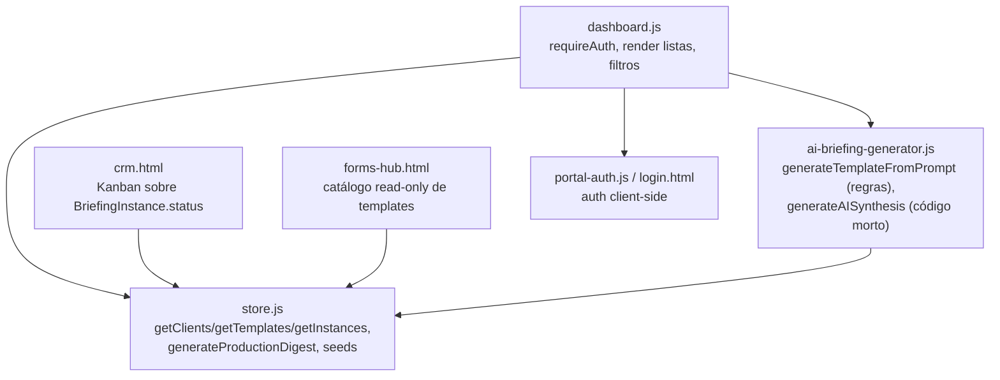
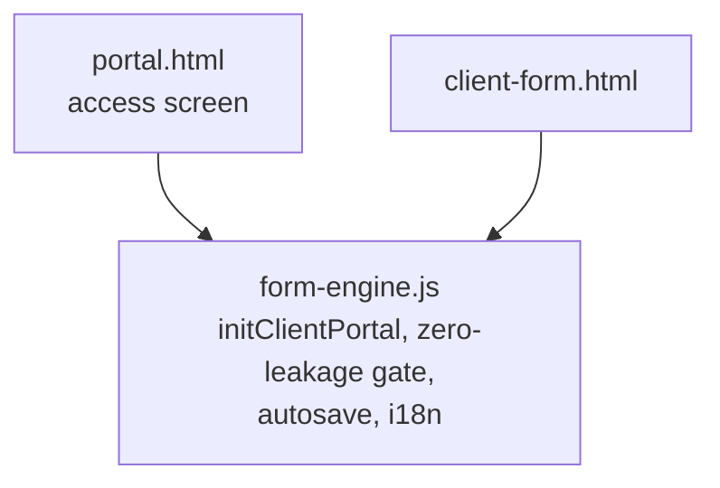
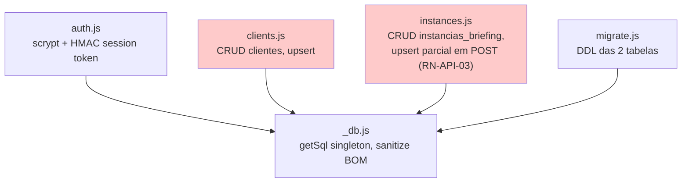

# C4 — Nível 3: Componentes

## Container: Painel do Estúdio (front-end)

## Container: Portal do Cliente (front-end)

## Container: API (Vercel serverless)

Nenhum dos 3 handlers de API (`auth.js` é exceção parcial — ele PRODUZ a sessão, mas não é CONSUMIDO por `clients.js`/`instances.js`) importa ou verifica a sessão gerada por `auth.js` — confirma visualmente o RN-API-01.
