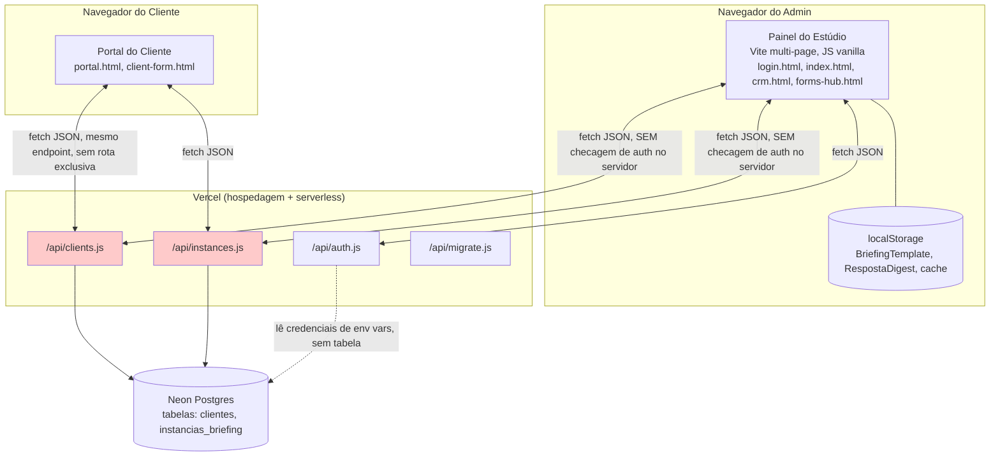

# C4 — Nível 2: Containers

`BriefingTemplate` e `RespostaDigest` nunca saem do `localStorage` do navegador do admin — não aparecem neste diagrama como dados do Postgres porque não estão lá (ver `erd-complete.md` e `domain.md`).
