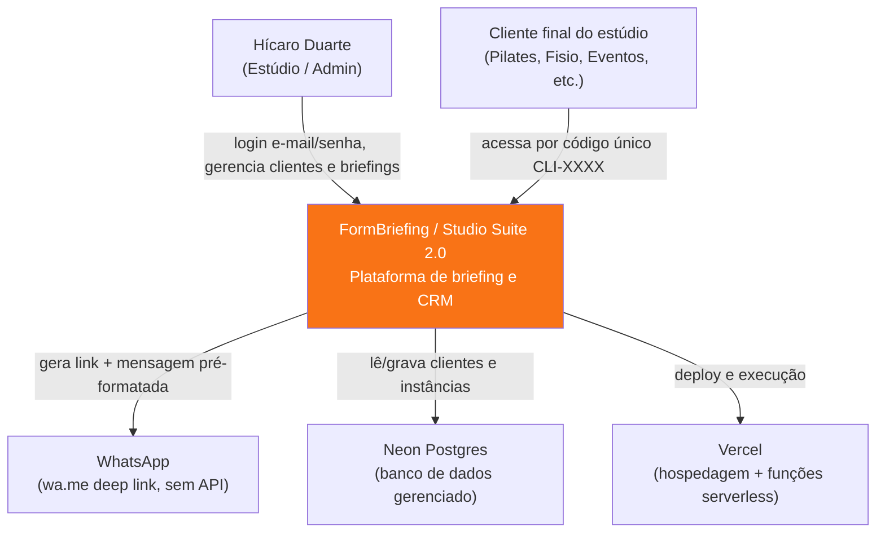

# C4 — Nível 1: Contexto

Não há integrações reais com serviços de IA (Gemini/Claude/GPT), e-mail transacional, ou calendário — apesar de mencionados em mockups/manual de implementação. `mailto:` é só um link estático de suporte.
