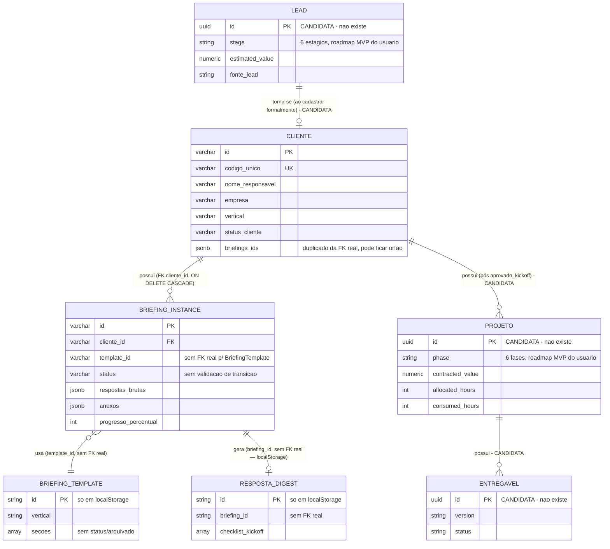

# ERD Completo — FormBriefing / Studio Suite 2.0

> 🟢 = entidade real (Postgres ou localStorage, confirmada no código) · 🔴 = candidata, não existe hoje (ver `data-dictionary.md` para campos detalhados)

## Notas sobre integridade referencial

- 🟢 `BriefingInstance.cliente_id → clientes.id` é a única FK real no banco (`ON DELETE CASCADE`, confirmado em `api/migrate.js`).
- 🔴 `BriefingInstance.template_id` **não** é uma FK de banco — é só uma string que deve coincidir com um `id` de `BriefingTemplate` no `localStorage`; não há integridade garantida (um template pode ser apagado do `localStorage` e a instância continuaria referenciando um id inexistente, sem erro).
- 🔴 `Cliente.briefings_ids` (JSONB) duplica a mesma relação que a FK real já expressa — mantido manualmente, pode ficar órfão (RN-API-04, já registrado no módulo `api-backend`).
- 🔴 `RespostaDigest.briefing_id` também não é FK real — mesma limitação de `BriefingTemplate`.
