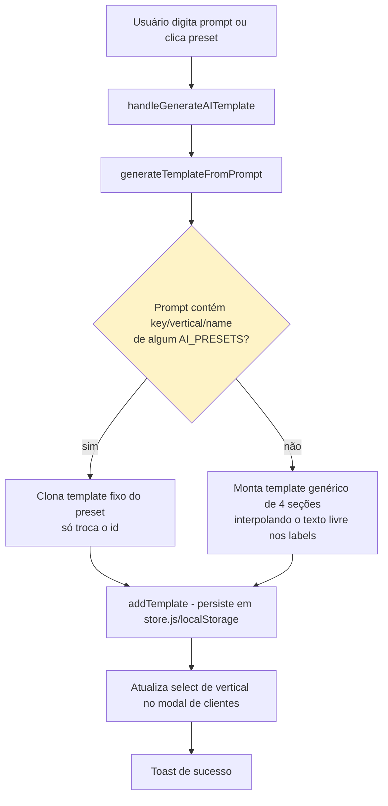
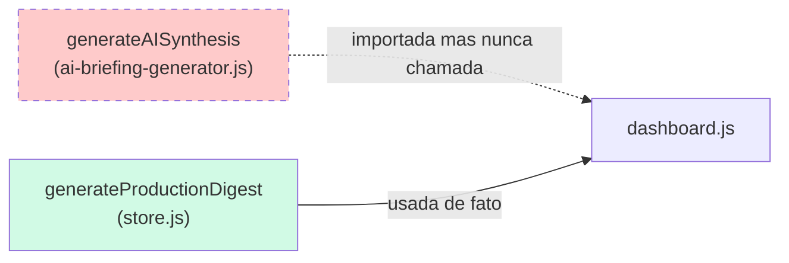

# Fluxograma — módulo `ai-briefing-generator`

## generateTemplateFromPrompt — "IA" real é matching de regras

Nenhuma chamada de rede a um LLM real ocorre em nenhum ramo deste fluxo — `AI_BRIEFING_SYSTEM_PROMPT` é só uma string de documentação, nunca enviada a lugar nenhum.

## Código morto confirmado

