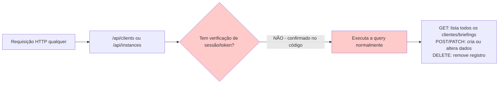

# Fluxograma — módulo `api-backend`

## Resolução de conexão (_db.js)

```mermaid
flowchart TD
    A[getSql chamado] --> B{sqlClient já existe?}
    B -->|sim| C[Retorna client cacheado]
    B -->|não| D[Tenta DATABASE_URL]
    D -->|vazio| E[Tenta POSTGRES_URL]
    E -->|vazio| F[Tenta POSTGRES_PRISMA_URL]
    F -->|vazio| G[Tenta DATABASE_URL_UNPOOLED]
    G -->|vazio| H[Tenta POSTGRES_URL_NON_POOLING]
    H -->|todas vazias| I[Lança erro explícito]
    D -->|achou| J[sanitize: remove BOM/espacos]
    E -->|achou| J
    F -->|achou| J
    G -->|achou| J
    H -->|achou| J
    J --> K[neon(connStr) cria client]
    K --> C
```

## Gap de segurança — requisição direta sem passar pelo login



`requireAuth()` (módulo `auth`) só existe no front-end (`dashboard.js`) — nunca é chamado dentro destes handlers. Qualquer cliente HTTP que conheça a URL do deploy ignora totalmente o login.
