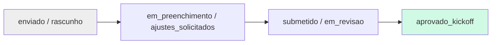
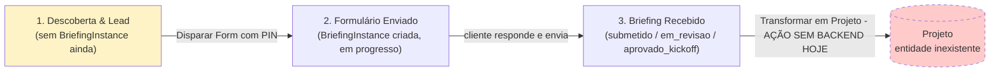
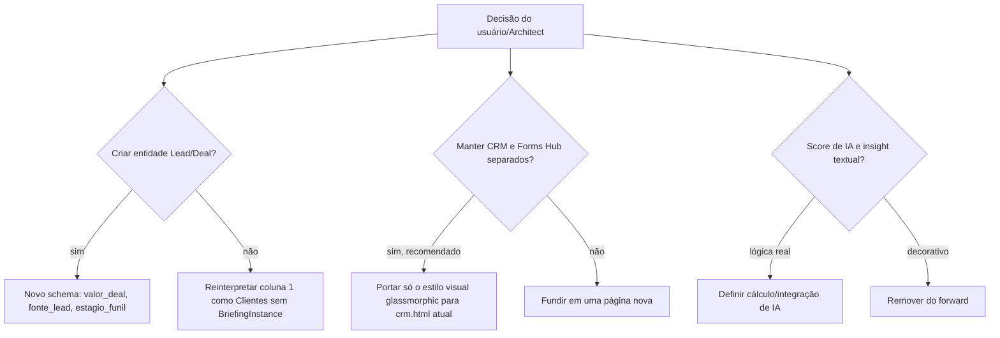

# Fluxograma — módulo `crm-funil`

## Implementação atual (crm.html) — 4 colunas por status real

Drag-and-drop entre colunas chama `updateBriefingStatus` direto — sem passar por nenhuma etapa de "lead" anterior ao envio do briefing.

## Funil conceitual do mockup — 3 estágios, começando ANTES do briefing existir

## Gap a resolver antes do /reversa-forward

