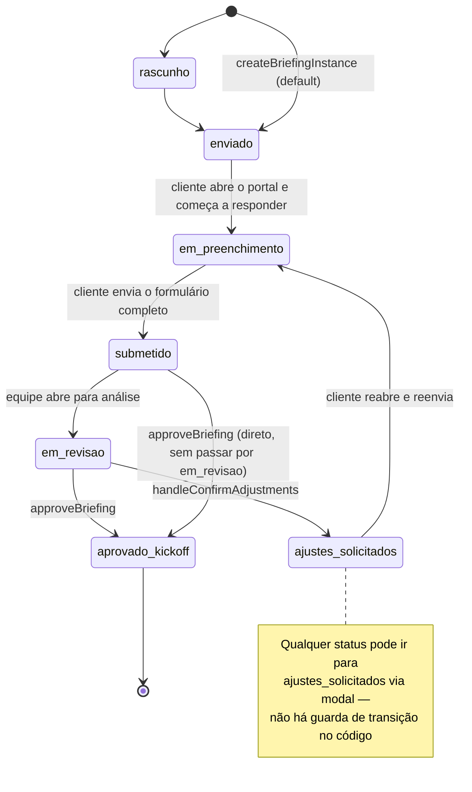
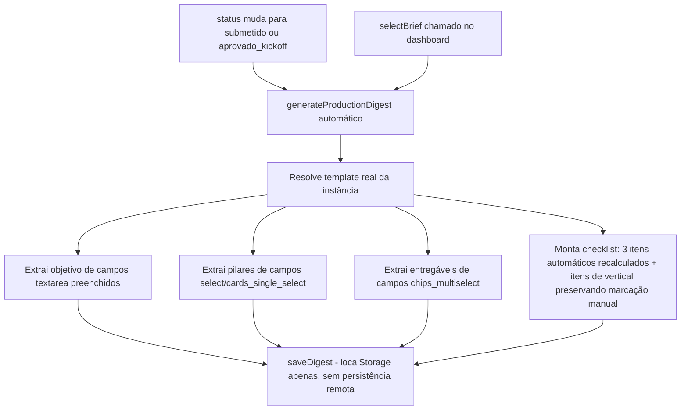
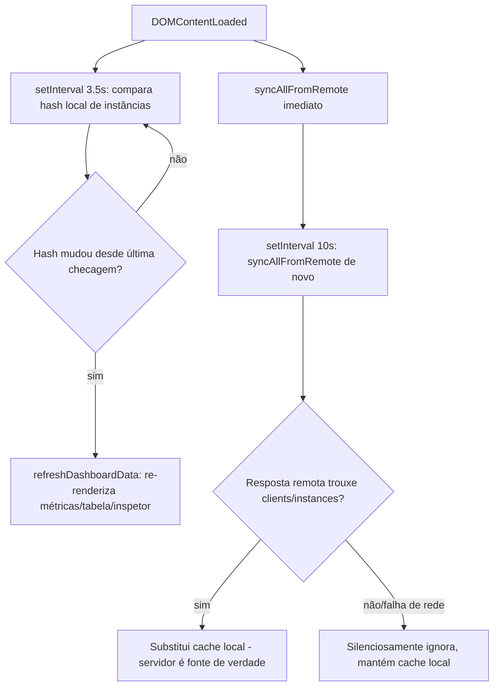

# Fluxograma — módulo `dashboard-core`

## Máquina de estados do BriefingInstance (observada no código, sem validador formal)

## Ciclo de vida do Digest (Resumo Executivo)

## Sincronização dashboard ↔ Neon (polling, não realtime)

