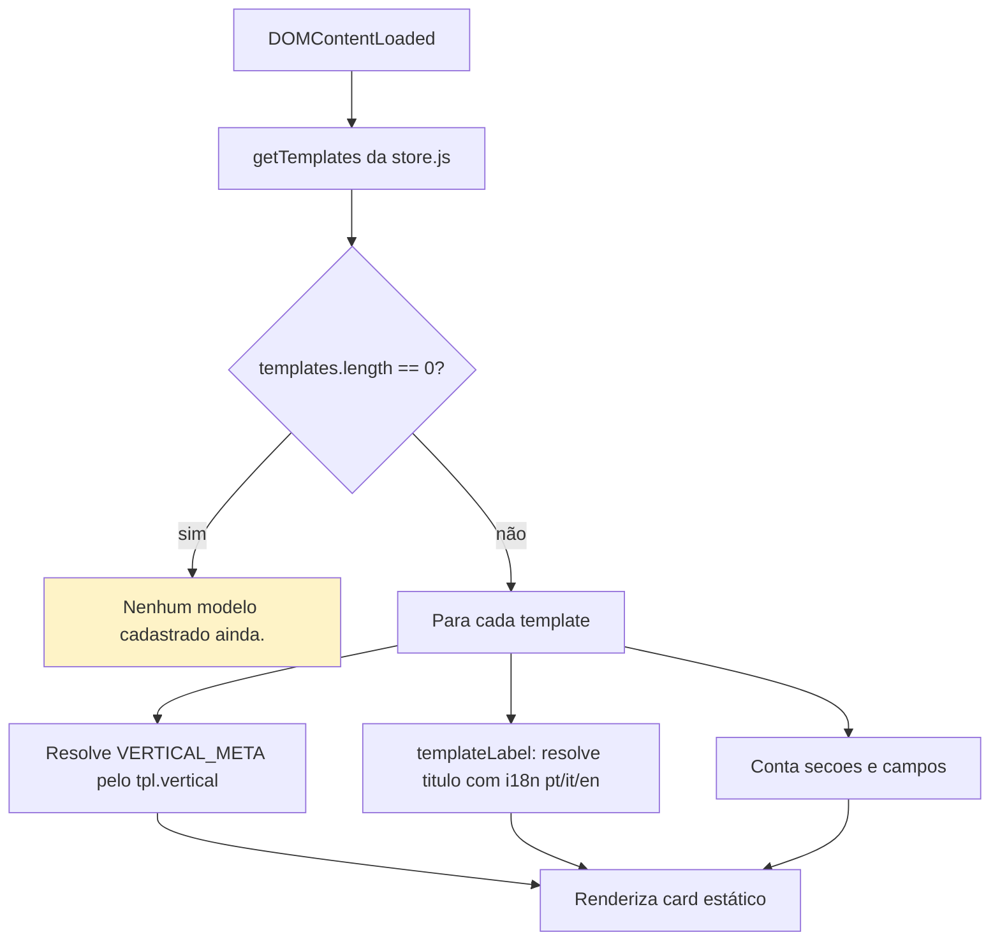
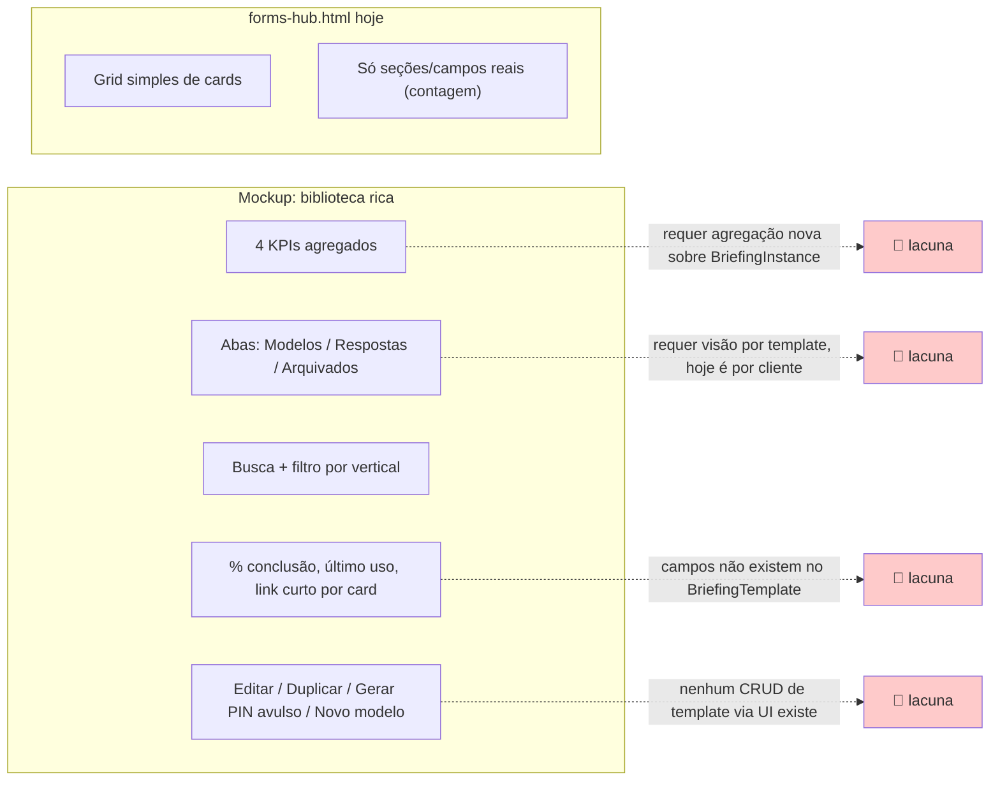

# Fluxograma — módulo `forms-hub`

## Fluxo real (forms-hub.html → render())

Sem clique, sem busca, sem filtro, sem criação/edição — 100% leitura.

## Mockup (06_studio_suite_forms_hub_biblioteca) — superfície x realidade

