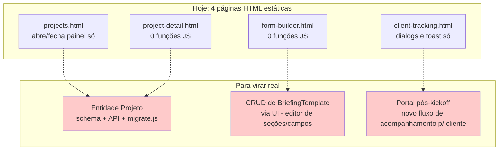

# Fluxograma — módulo `telas-preview-v2`

## O que existe vs. o que seria necessário

Nenhuma das 4 telas importa `store.js`, usa `localStorage` ou chama `/api/*` — confirmado por busca direta no código, não por inferência.
