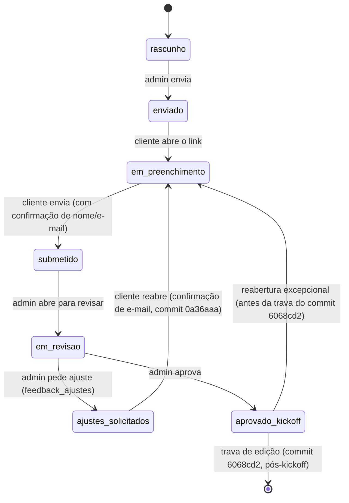
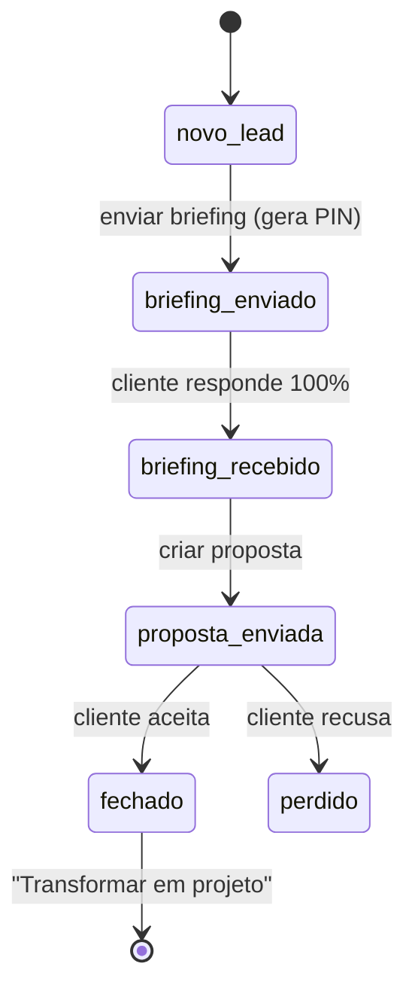
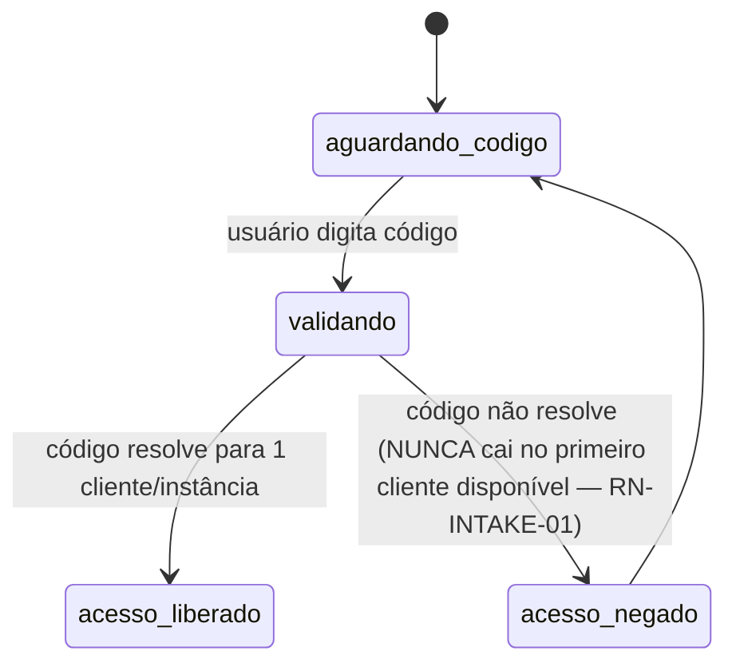

# Máquinas de Estado — FormBriefing / Studio Suite 2.0

> Gerado pelo Detective. Escala de confiança: 🟢 CONFIRMADO | 🟡 INFERIDO | 🔴 LACUNA

---

## 1. `BriefingInstance.status` (entidade central do sistema)

🟢 Valores confirmados em `store.js`/`dashboard.js`/`api/migrate.js`: `rascunho`, `enviado`, `em_preenchimento`, `submetido`, `em_revisao`, `ajustes_solicitados`, `aprovado_kickoff`.

🔴 **LACUNA confirmada (RN-CORE-04):** não existe nenhuma função de validação de transição no código — qualquer valor de `status` pode ser escrito diretamente via `PATCH /api/instances` sem checagem contra o diagrama acima. O diagrama representa o fluxo **pretendido** pelas regras de negócio observadas no histórico Git (ex: trava pós-`aprovado_kickoff`), não uma validação real.

🟡 **Reabertura excepcional:** o commit `0a36aaa` ("Permite reabrir briefing já enviado para edição, com confirmação de e-mail") sugere que existe um caminho de volta de qualquer status para `em_preenchimento`, mediado por confirmação manual de e-mail no client-side — não uma regra de máquina de estados formal, mais uma função de UI isolada.

---

## 2. Funil de vendas (Lead) — 🔴 não implementado, desenhado no roadmap

Conforme `prompts_stitch_studio_suite_2.1.md` (tela 03), o usuário especificou 6 estágios — distintos da máquina de estados acima:

Nenhuma destas transições tem código correspondente hoje — toda a máquina é 🔴 lacuna, mas com especificação de produto já definida pelo usuário.

---

## 3. PIN de acesso do cliente — 🟢 confirmado, mais simples que o mockup descreve

O mockup descreve um PIN numérico de 6 dígitos com bloqueio após 3 tentativas e expiração por tempo. O código real usa `codigo_unico` (`CLI-XXXX`, alfanumérico, sem expiração nem contagem de tentativas):

🔴 **LACUNA:** não há bloqueio por tentativas nem expiração do código no código real — ambos existem só no mockup/manual de implementação.
